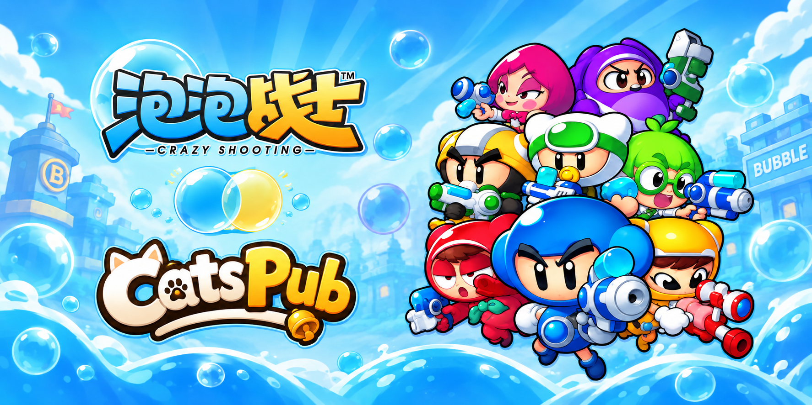

<div align="center">



# BubbleFighter CN0280 Server

**面向国服 BubbleFighter 0.2.80.1 客户端的 Windows C++ 服务端实现**

本地账号 · 角色与背包 · 广场与商店 · 多人房间 · 对局结算


[](LICENSE)
[](https://github.com/K1roSama/BubbleFighter_CN0280_Server/actions/workflows/windows.yml)


[下载 Release](https://github.com/K1roSama/BubbleFighter_CN0280_Server/releases/latest) · [快速上手](#快速上手) · [构建指南](docs/build.md) · [运行与接入](docs/usage.md) · [文档与贡献](#文档与贡献)

<table aria-label="community">
<tr>
<td align="center" width="280">
  <a href="https://qm.qq.com/q/fAcNMJVyuI">
    <br>
    <strong>加入泡泡战士 K1ro 服社区</strong>
  </a>
</td>
<td align="center" width="280">
  <a href="https://afdian.com/a/K1roSama1337">
    <br>
    <strong>通过爱发电支持我们</strong>
  </a>
</td>
<td align="center" width="280">
  <a href="https://ko-fi.com/k1rosama">
    <br>
    <strong>请我们喝杯咖啡</strong>
  </a>
</td>
</tr>
</table>

---

<table aria-label="CatsPub AI">
<tr>
<td align="center" width="840">
  <a href="https://catspub.com">
    <br />
    <strong>本项目由 Catspub 中转站获得支持</strong>
  </a><br />
  <sub>稳定 · 快速 · 用户至上</sub>
</td>
</tr>
</table>

</div>

## 项目介绍

这是一个面向 CN0280（`0.2.80.1`）客户端的 Windows 控制台服务端。账号、角色、库存与结算等持久化数据使用 MySQL，网络、会话与玩法逻辑使用 C++20 实现。

Visual Studio 解决方案只有 **BubbleFighter.Server 一个工程**，统一生成 `BubbleFighter.Server.exe`。主网关、启动器认证、独立登录、专用房间、节点代理、数据库迁移与账号管理共用这个程序，通过运行模式选择入口。

**源码仓库不包含游戏客户端、启动器、数据库软件或编译产物；可运行的服务端包通过 [Releases](https://github.com/K1roSama/BubbleFighter_CN0280_Server/releases) 提供。** 游戏接入需要匹配的 CN0280 客户端，以及能够调用本地账号认证与一次性登录票据的启动器，详见[运行与接入](docs/usage.md)。

| 模块 | 源码覆盖的流程 |
| --- | --- |
| 账号与登录 | 账号注册、密码校验、一次性票据签发与消费、重复登录处理 |
| 角色与菜单 | 角色创建、角色资料、等级经验、货币及菜单初始化 |
| 背包与装备 | 普通与 Cash 道具、装备切换、预设、道具使用与属性计算 |
| 广场与社交 | 在线成员、移动状态、聊天、好友、私聊、情侣与战队 |
| 商店与活动 | 商品目录、购买与领取、礼包、神秘商店、寻宝、工坊与签到 |
| 练习与小游戏 | 教程、单人练习、训练房及大厅小游戏 |
| 房间与对局 | 房间创建、加入离开、准备、房主变更、加载、开局和返回房间 |
| 玩法逻辑 | 普通 PVP，以及爆破、道具、感染、僵尸 PVE、躲猫猫、武器大师、竞速等模式的处理代码 |
| 结算与恢复 | 奖励、统计、资产事务、结算重试、房间所有权与恢复约束 |
| 运维与扩展 | 英文日志、就绪检查、人工封禁与禁言、独立房间与节点代理 |


## 快速上手

从 [Releases](https://github.com/K1roSama/BubbleFighter_CN0280_Server/releases/latest) 下载 `BubbleFighter-CN0280-Server-win-x64.zip` 并解压，或按[构建指南](docs/build.md)自行编译。安装 x64 Visual C++ v14 运行库，完成 MySQL 空库迁移和账号授权。

1. 编辑 EXE 旁的 `config/server.conf`，填写数据库地址、库名和运行账号。
2. 编辑 `config/mysql.password`，将 `CHANGE_ME` 换成该数据库账号的密码，文件只保留一行。
3. 确认 MySQL 已启动，双击 `BubbleFighter.Server.exe`。
4. 在匹配的客户端启动器中配置 `127.0.0.1:27100`，完成账号注册、密码登录和游戏票据接入。

程序无参数启动时自动使用 EXE 所在目录，读取 `config/server.conf`，不需要 CMD 或启动脚本。数据库需要提前准备并启动；双击服务端不会安装或启动 MySQL。

启动成功会在英文日志中显示：

```text
[Server] Startup completed. Accepting client connections.
```

| 默认端点 | 用途 |
| --- | --- |
| `127.0.0.1:27100` | 游戏网关与启动器注册、登录 |
| `127.0.0.1:27101` | 战队服务 |
| `127.0.0.1:27104` | 装备中继 |
| `http://127.0.0.1:27102/ready` | 本机就绪检查 |
| `127.0.0.1:3306` | MySQL，要求 TLS |

在控制台按 **Ctrl+C** 有序停止服务端。MySQL 的启动与停止由数据库自身管理。局域网、公网地址和独立登录的设置见[运行与接入](docs/usage.md)。

## 构建与部署

| 项目 | 要求 |
| --- | --- |
| 系统与平台 | Windows x64，Debug / Release |
| 编译器 | Visual Studio 2022，C++ 桌面开发组件，MSVC `v143` |
| 语言与 SDK | C++20，Windows SDK `10.0.26100.0` |
| 构建脚本 | Python 3.12 或更新版本、Windows PowerShell |
| 数据库开发文件 | Oracle MySQL `8.4.11` Windows x64 的头文件、导入库与运行 DLL |
| C++ 依赖 | vcpkg：Boost.Asio、nlohmann/json、OpenSSL、spdlog；libjuice 源码随仓库提供 |
| 运行库 | x64 Visual C++ v14 Redistributable |

在 Visual Studio **Developer PowerShell** 中执行：

```powershell
git clone https://github.com/K1roSama/BubbleFighter_CN0280_Server.git
cd .\BubbleFighter_CN0280_Server
.\build\fetch_mysql_sdk.ps1
.\build\restore_dependencies.ps1
msbuild .\BubbleFighter.Server.sln /m /p:Configuration=Release /p:Platform=x64
```

也可以在设置好依赖后打开 [BubbleFighter.Server.sln](BubbleFighter.Server.sln)，选择 `Release / x64` 生成。构建会复制 MySQL 客户端 DLL，并准备 EXE 旁的配置、数据和迁移目录，已存在的主配置与密码文件不会覆盖。

首次使用需要显式运行 `--mode migrate`；重复运行时已完成的迁移会跳过。不要把迁移 SQL 当作普通脚本拆开执行，迁移器会记录步骤和校验值。完整数据库准备方法见[构建指南](docs/build.md#数据库准备)。

## 文档与贡献

| 文档或目录 | 内容 |
| --- | --- |
| [构建指南](docs/build.md) | 工具链、依赖恢复、MySQL 准备、迁移与生成 |
| [运行与接入](docs/usage.md) | 配置、客户端接入、命令行、日志和账号管理 |
| [配置示例](config/examples) | 主服务、独立登录、数据库管理、房间与 ICE 模板 |
| [数据库迁移](src/persistence/migrations) | MySQL 结构、种子数据和校验合同 |
| [发布资源](data/published) | 商品目录、奖励和服务规则 |
| [第三方说明](docs/third_party.md) | libjuice、词库历史来源及依赖许可证 |

本仓库保留构建与运行所需的源码和资源。`build` 中的脚本负责 SDK 下载与校验、依赖恢复、运行目录准备和发布打包；不包含测试工程、开发工具集合、历史验收材料、编译产物或本机数据库。

欢迎通过 [Issues](https://github.com/K1roSama/BubbleFighter_CN0280_Server/issues) 反馈问题或提交 Pull Request。请附上客户端版本、服务端提交、复现步骤及必要日志，并移除密码、登录票据和其他私有配置。

## 许可证

项目代码采用 [MIT License](LICENSE)。第三方组件保留各自许可证；游戏名称、商标和相关美术资源的权利归原权利人所有。
